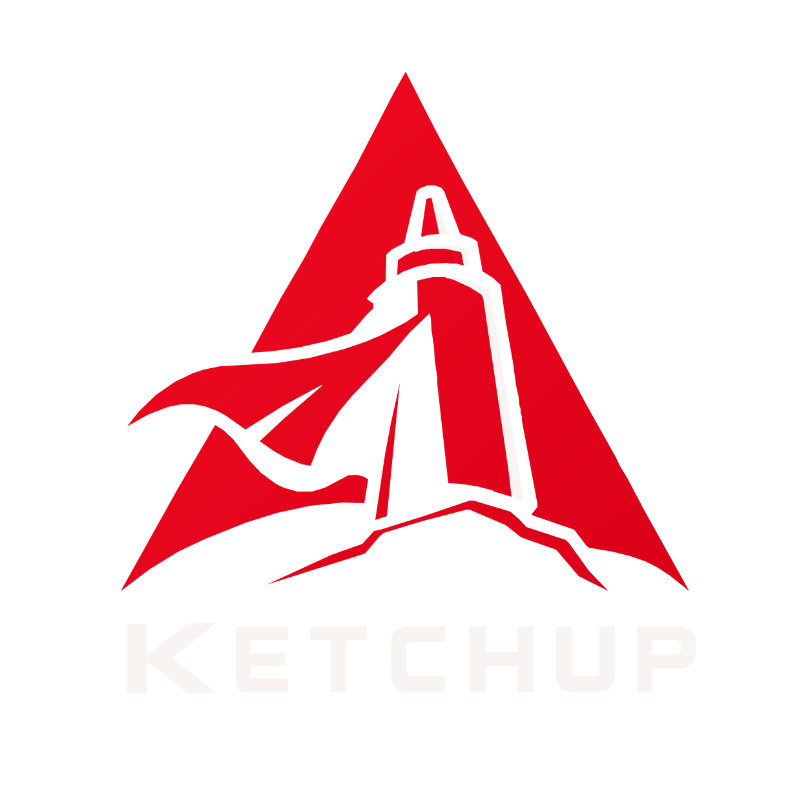

<p align="center"></p>

# Ketchup

A fast, slim, Arch-based desktop OS: **KDE Plasma + linux-zen + Rust tooling + Distrobox**, built from the
[CachyOS Live ISO](https://github.com/CachyOS/CachyOS-Live-ISO) profile and rebranded. The ISO is built by GitHub Actions.

## What's different from the CachyOS live ISO

| Area | Ketchup |
|---|---|
| Kernel | `linux-zen` from Arch `extra` (desktop-oriented patch set) |
| Boot loader | **Limine** (BIOS + UEFI, hybrid USB). Installed systems get a generated menu, hash-pinning of kernel/initramfs, `ketchup-limine` + pacman hook; GRUB only as fallback on BIOS machines Limine cannot read |
| Learn the OS | **Ketchup Lens**: real program traces *and* a single-step toy computer (CPU, MMU/TLB, cache, RAM, disk, kernel) |
| Security | `ketchup-audit` self-check, kernel hardening sysctls, signature-verified pacman on the installed system, tamper-evident boot |
| Tuning | Ketchup's own sysctl, udev I/O schedulers, zram (zstd), BBR, `ananicy-cpp`, `scx_lavd`, `systemd-oomd`, weekly `fstrim` |
| Installer | Calamares with a new "ketchup" branding and config; offline install of the live image; btrfs + zstd + subvolumes default |
| Rust tools | alacritty, eza, bat, fd, ripgrep, sd, dust, procs, bottom, zoxide, starship, yazi, helix, zellij, tealdeer, paru |
| Containers | Distrobox + Podman (rootless, preconfigured) |
| Apps | Flatpak + Flathub + Discover |
| Look | Dark Breeze, tomato accent, Ketchup mascot logo/icon theme/wallpaper, Limine menu wallpaper |
| Memory | No copy-to-RAM at boot, no file indexer, no Discover; zram + zstd swap |
| Study | Network-namespace lab, kernel-module / boot-sector / syscall skeletons, gdb, strace, perf, bpftrace, tcpdump, wireshark-cli |
| Slimming | No ZFS, Clonezilla, VM-guest agents beyond QEMU/SPICE, modem/ppp/VPN extras, CJK fonts, IRC/text browsers, GParted, Kate, etc. |

## Build

Push to GitHub: `.github/workflows/build-iso.yml` builds the ISO (artifact on every run; GitHub Release on tags like `v2026.11`).

Locally on Arch/CachyOS:

```bash
sudo pacman -S archiso mkinitcpio-archiso squashfs-tools grub git limine libisoburn
./buildiso.sh -v        # ISO ends up in out/desktop/
```

Edit `archiso/packages_desktop.x86_64` to add or remove packages.

**How the ISO gets Limine:** `mkarchiso` only knows syslinux/systemd-boot/GRUB, so it first builds the stock ISO (scaffolding: `archiso/syslinux`, `grub`, `efiboot` stay for that), then `util-iso.sh: make_limine_iso` re-packs the same file tree with Limine as the only boot loader (`archiso/limine/limine.conf.in`). Debug a build over serial with `KETCHUP_LIVE_EXTRA=console=ttyS0 ./buildiso.sh -v`.

**Regenerate branding** (logo, icons, wallpapers, splash, Calamares images) from the mascot SVGs in `archiso/airootfs/usr/share/ketchup/mascot/`: `pip install cairosvg fonttools && tools/make-assets.py`. Tests: `node tools/test-kvm.js`.

## Tools shipped on the ISO

* **`ketchup-rebrand`** - one command to rename and re-skin the OS, live or installed: name, hostname, logo, accent colour, wallpaper, boot-menu title, installer text. Run it with no arguments for dialogs, or `sudo ketchup-rebrand --name "MyOS" --logo my.svg --hostname box --accent '#33aa66'`. `--reset` restores Ketchup.
* **`ketchup-doctor`** - writes `~/ketchup-diagnostics.txt` (boot time, IRQ errors, RAM, NetworkManager, installer libs) to paste into a bug report.
* **`ketchup-lab`** / **`ketchup-devtools`** - networking and OS-internals labs (network namespaces, kernel module, boot sector, raw syscalls) and on-demand toolchains. Notes: `/usr/share/doc/ketchup/STUDY.md`.
* **`ketchup-logo`** - change the logo after boot (menu button, About, installer). `ketchup-logo set my.svg` (or `.png`), `sudo ketchup-logo set my.svg` for all users, `ketchup-logo reset`. Also in the app menu as *Change Ketchup Logo*.
* **Blue mode** - `mythical-blue-ketchup` swaps the panel logo/icon theme to blue for this login only (auto-reverts on logout/restart, or instantly with `the-legacy-red-ketchup`). While it's on you can use `ketchup-blue-vault create|open|close|status|wipe` (a gocryptfs-encrypted folder at `~/BlueVault`) and `ketchup-blue-apps create|enter|install|list|wipe` (a disposable Distrobox sandbox) - both locked to blue mode and both one command to delete. Also in the app menu as *Enter Blue Mode*.
* **`about.html`** (`/usr/share/ketchup/about.html`, app menu *About Ketchup*) - renders this project's README live from GitHub.
* **`ketchup-apps-location`** - choose where apps are installed: `ketchup-apps-location flatpak /mnt/bigdrive`, `... distrobox /mnt/bigdrive`, or run it with no arguments for a dialog. Pacman packages always go to `/usr`; to put them on another disk, mount that disk at `/opt` or `/var` via fstab.
* **`ketchup-mirrors`** - rank the fastest Arch mirrors.
* **`ketchup-v3`** - opt in to CPU-optimised x86-64-v3 packages from the CachyOS repos (`ketchup-v3 off` to undo).

## IRQ 27 "nobody cared"

`irq 27: nobody cared ... Disabling IRQ #27` means a device raised an interrupt that no driver claimed, so the kernel switched that interrupt line off (the device then stops working or stalls boot).
Every Ketchup boot entry (live and installed) now carries `noirqdebug`, which stops the kernel from ever disabling an IRQ. That is safe for message-signalled (MSI) interrupts (IRQ numbers above 23 on x86 almost always are), but it hides the symptom; the cause is a driver/firmware bug.
Find the device: `ketchup-irqfix 27` (device, driver, trigger type, kernel messages, advice). The live menu has an *IRQ troubleshooting* submenu (`irqfixup`, `irqpoll pci=nomsi`, and a "stock kernel" entry for diagnosing); on an installed system `sudo ketchup-irqfix apply irqfixup|irqpoll|nomsi|noirqdebug|default`.

## Learn how the OS works: Ketchup Lens

* `ketchup-lens sim` - **KetchupVM**, a toy computer to single-step: registers, page tables, TLB, L1 cache, RAM frames, disk, system calls, timer interrupts, scheduler, page cache. Seven programs, each demonstrating one idea.
* `ketchup-lens trace -- ./program` - runs a real program under strace, perf, gdb and a /proc sampler and writes an interactive HTML report: life of the process, every syscall explained, address-space snapshots, registers at the syscall boundary, CPU counters, your cache hierarchy and a measured latency curve (`ketchup-lens latency`), disk vs page cache.
* `ketchup-lens samples` builds small C programs for it; `ketchup-lens hw` prints your CPU/cache/RAM/disk map. Guide: `/usr/share/doc/ketchup/STUDY.md` (Track 3).

## Security

`sudo ketchup-audit` (add `--lynis`, `--json`) checks boot chain, kernel hardening, accounts, network, package signatures and services. The method, threat model and the known weak spots of this build (e.g. build-time `SigLevel = Optional TrustAll` for the CachyOS repo) are in [`archiso/airootfs/usr/share/doc/ketchup/SECURITY-EVALUATION.md`](archiso/airootfs/usr/share/doc/ketchup/SECURITY-EVALUATION.md). Using your own package repo instead of CachyOS: [`docs/OWN-REPO.md`](docs/OWN-REPO.md).

## Rebranding checklist

The GitHub links in `archiso/airootfs/etc/os-release`, `profiledef.sh` and `archiso/airootfs/usr/share/calamares/branding/ketchup/branding.desc` already point at `github.com/ANANDHUAJITH/ketchup`; update them again if you ever move to an org instead of your personal account.
Default time zone in the installer is Asia/Kolkata (`archiso/airootfs/usr/share/ketchup/calamares/modules/locale.conf`).

## Credits & license

GPL-3.0. Based on the CachyOS Live ISO profile and Arch Linux `archiso`. Ketchup is an independent project and is not affiliated with CachyOS.
