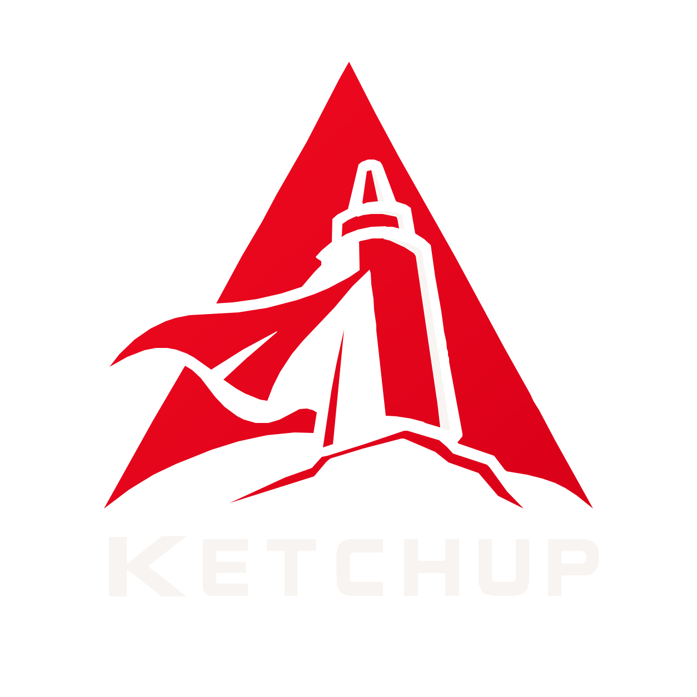

<p align="center">
  
</p>

# Ketchup

Ketchup is an Arch-based desktop operating system built around the
[niri](https://github.com/YaLTeR/niri) scrolling-tiling Wayland compositor, the
[Noctalia](https://github.com/noctalia-dev) shell and the `linux-zen` kernel. It is based on the
[CachyOS Live ISO](https://github.com/CachyOS/CachyOS-Live-ISO) profile, with its own desktop,
boot experience and tooling. niri is the only session.

Login is a graphical screen (greetd with the Noctalia Greeter, Ayu colour scheme by default,
F7 to switch scheme). The live image opens on the `liveuser` step; the password is empty, so
press Enter.

## Features

- Limine boot menu for BIOS and UEFI.
- Calamares installer that also works offline. New installs use Btrfs with zstd compression
  and subvolumes.
- The live image reads its root filesystem from the boot medium (`copytoram=n`) instead of
  copying it into RAM.
- zram with zstd, weekly `fstrim`, BBR, per-device I/O scheduler rules, and configuration
  for `ananicy-cpp`, `scx_lavd` and `systemd-oomd`.
- Flatpak with Flathub, Podman and Distrobox.
- Command-line tools such as `bat`, `fd`, `ripgrep`, `zoxide`, `yazi`, Helix and Zellij.

## Building the ISO

The ISO is built in an `archlinux:base-devel` container by
[`ci-build.sh`](ci-build.sh), which the GitHub Actions workflow runs on every push and monthly.
To build locally on an Arch system with `archiso`, `squashfs-tools`, `libisoburn`, `limine`,
`grub` and `mtools` installed:

```bash
./tools/build-aur-packages.sh   # builds noctalia and matugen into archiso/local-repo
./buildiso.sh -w                # the ISO is written to out/desktop/
```

Run `./buildiso.sh -h` for the options. `tools/ensure-symlinks.sh` recreates the systemd
symlinks the image depends on; the build runs it automatically, and `--check` reports any
that are missing.

## Updates

Ketchup is rolling and carries a release train number (`26.0`, `27.0`, ...); `ketchup-version`
shows it.

- `ketchup-upgrade` applies an update inside a new Btrfs snapshot and switches the boot menu
  to it only after every step succeeded. The previous system, including its kernel, stays
  bootable as "Ketchup (previous system)". If a fresh update fails to reach a working login
  three boots in a row, it is rolled back automatically.
- `ketchup-upgrade check`, `history` and `prune` look for updates, list snapshots and delete
  old ones. `ketchup-rollback` makes a rollback permanent.
- Announcements from `notif.yml` appear as desktop notifications.
- Custom wallpapers and branding in `/var/lib/ketchup/assets` survive updates and rollbacks.

Details, including what to publish for the package repository and `notif.yml`, are in
[`docs/UPDATES.md`](docs/UPDATES.md).

## Tools

| Command | Description |
|---|---|
| `ketchup-doctor` | Collect diagnostics (boot time, memory, network, IRQ errors) into `~/ketchup-diagnostics.txt` |
| `ketchup-verify` | Check that Ketchup's commands, configuration and services are in place (`--cmds` lists the commands) |
| `ketchup-help-bugs` | Gather logs into one file and suggest fixes for known problems (`--500s` for a quick pass) |
| `ketchup-find` | Find files by extension, name, or with the `--wallpapers`, `--configs` and `--cmds` shortcuts |
| `ketchup-man` | Show the manual of Ketchup commands (`-l` for a list, `-k WORD` to search) |
| `ketchup-audit` | Security self-check; `--lynis` adds Lynis, `--json` prints JSON |
| `ketchup-irqfix` | Identify the device behind an `irq N: nobody cared` message and apply a fix |
| `ketchup-mirrors` | Rank Arch mirrors by speed |
| `ketchup-v3` | Opt in to x86-64-v3 packages from the CachyOS repositories (`ketchup-v3 off` undoes it) |
| `ketchup-apps-location` | Choose where Flatpak apps and Distrobox containers are stored |
| `mythical-blue-ketchup` / `the-legacy-red-ketchup` | Enter and leave blue mode (blue branding for the current login) |
| `ketchup-blue-vault`, `ketchup-blue-apps` | Encrypted folder and disposable Distrobox sandbox, available in blue mode |

## Learning tools

`ketchup-lens` explains what happens when a program runs:

- `ketchup-lens sim` opens KetchupVM, a small simulated computer with registers, memory,
  caches, disk, system calls, interrupts and scheduling.
- `ketchup-lens trace -- ./program` records a real program's system calls and runtime
  behaviour into an interactive HTML report.
- `ketchup-lens hw` prints the machine's CPU, cache, memory and storage layout.
- `ketchup-lens samples` builds small C programs for experiments.

`ketchup-lab` creates networking and OS-internals labs. The study notes are in
`/usr/share/doc/ketchup/STUDY.md`.

## Boot troubleshooting

If the screen stays black, use the "safe graphics (nomodeset)" entry. For
`irq 27: nobody cared` messages, run `ketchup-irqfix 27` or pick an entry under "IRQ
troubleshooting". The default entries pass `noirqdebug`, which keeps the kernel from
disabling the interrupt line but does not fix the driver or firmware behind it.

To see where boot time goes, run `ketchup-doctor` or
`systemd-analyze critical-chain display-manager.service`.

## Security

Run `sudo ketchup-audit` to check the boot chain, kernel settings, accounts, network
exposure, package signatures and services. The live session is intentionally open
(autologin, passwordless sudo and polkit); audit an installed system, not the live one. See
[`SECURITY-EVALUATION.md`](archiso/airootfs/usr/share/doc/ketchup/SECURITY-EVALUATION.md)
for the threat model and known limitations.

## License

Ketchup is licensed under GPL-3.0. It is based on the CachyOS Live ISO profile and Arch Linux
`archiso`, and is an independent project not affiliated with CachyOS.
